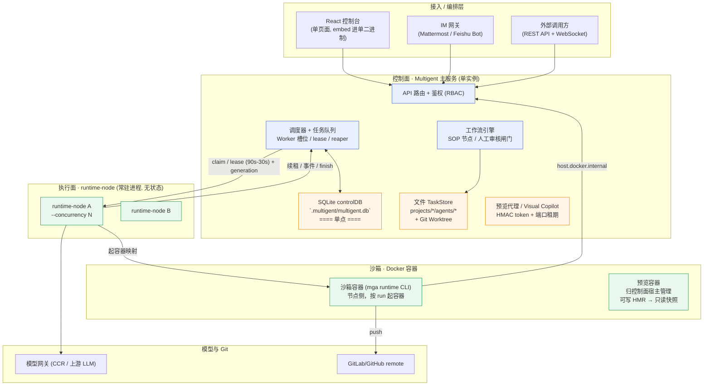
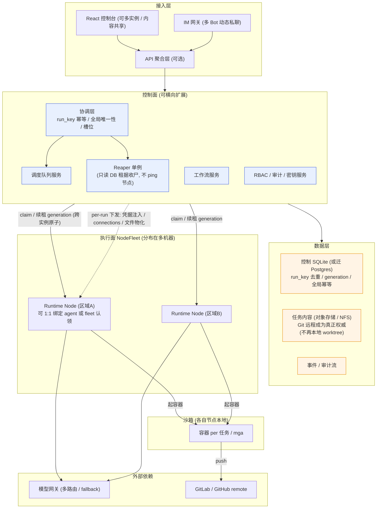
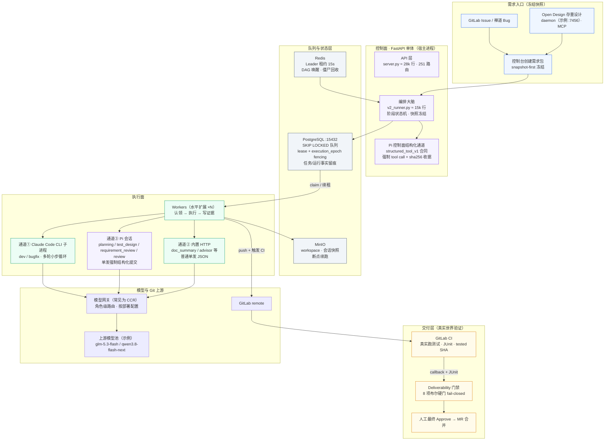
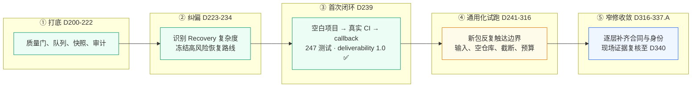

# Multigent 架构分享：现状 → 分布式改造

> 面向讲解用。两幅 Mermaid 架构图 + 每层要点 + 改造前后的关键转变对比。
> 素材均来自代码核实（HANDOFF.md / internal/db / internal/api / cmd/multigent）。
> AITP/Open Design 部分按 2026-09-13 的现场证据修订；端口、模型和运行状态都是环境快照，不能当成产品固定值。

---

## 0. 分布式差异总览（先看这个结论）

> 一句话：**Multigent 与 AITP 的"执行面"已经是同一套思想（无状态 worker + 租约 + 原子认领）；真正的差距在"控制面状态放哪、谁有资格当交付裁判"两处。** Multigent 的分布式改造不是重写，是把下面表的第 1 列挪成第 2 列——而 AITP 就是你已实现该状态的参照系。

| 维度 | ① Multigent **现状** | ② Multigent **分布式目标** | ③ AITP（=目标已实现的参照） |
|---|---|---|---|
| 执行面 | runtime-node 无状态可扩 | 同左（已具备） | Workers 无状态可扩（同构） |
| 控制面状态 | ⚠️ **单机 SQLite + 本地磁盘**（单点） | 多实例 + 状态外置 | **PG/Redis/MinIO 原生外置** |
| 原子认领 | ⚠️ SQLite 事务 claim（单机内原子） | 同左 → 升到分布式协调 | PG `SKIP LOCKED` + lease/epoch |
| 防重复执行 | `lease + lease_generation` 条件更新 | 同左（已是 fencing） | `lease + execution_epoch` fencing |
| 编排对象 | 单个 Agent 任务 + 工作流状态机（12 步统一交付流水线、Webhook/Cron/Event 触发器） | 同左（跨实例可扩展） | **整条交付流水线**（阶段状态机） |
| 交付裁判权 | ⚠️ 部分机器可验证：ci_ready 闸门（HEAD SHA 流水线证据）+ Agent 初审闸门 + 人工审核自动收编，但未全链路强制 fail-closed | 全链路机器可验证门禁 | **真实 CI + fail-closed 门禁** |
| 可信基线 | ⚠️ 代码核实 | 待加强 | **全量 PG 留痕，可回放** |

**怎么读这张表**
- **欠缺点（① → ② 的 gap）**：加粗 ⚠️ 的行 = 控制面状态外置、原子认领升到协调层、交付裁判权全链路强制、可信留痕——这几行正是 Multigent 目前**还没做完**的，也是 Q0 / roadmap 里排的下一步。
- **与 AITP 的差（① → ③）**：AITP 天生就是 ② 的"已实现形态"，读这张表 = 逐行问"这一维度 AITP 已经给了答案，我们何时对齐"。
- 两处 **同构**（执行面、防重复）说明 Multigent 方向是对的，不用推倒重来。
- 注意编排对象一行 Multigent 并不薄：工作流引擎（SOP 节点、人工审核闸门、触发器）已是现役能力，差距主要在"控制面可扩展性"而非"编排表达能力"。

---

## 第一幅：当前架构（单控制台 + 多 runtime-node）



**讲解要点（按层）**
- **控制面是严格单点**：调度、队列、工作流、预览全在同一个进程，靠 SQLite 的原子事务（`ClaimRuntimeRun`）保证"一个任务只被 claim 一次"。
- 作业模型：并发单位是 项目/agent 的心跳循环；**槽位是 Worker 级**；`lease + lease_generation` 控制，node 侧 90s 租约 / 30s 续租，reaper 在控制面收尸（租约到期 + 180s grace + 轮询，实测节点死亡到 run 被 reap 全链路约 4-5 分钟）。**node 无状态，但不自治**：续租失败（409）即取消本地 run，控制面挂掉，在跑的任务也会跟着终止——无状态的另一面是强依赖控制面存活。
- **agent→node 是 1:1 绑定**（agent 配置 `defaultRuntimeNodeId`），没有跨节点负载均衡；扩容 = 加机器 + 把 agent 绑过去。跨节点分摊单 agent 负载是分布式改造要解决的真问题之一。
- **单点约束是这套图最大的短板**：`DB` 与 `TS`（磁盘 git worktree）都挂在控制面进程；控制面挂，一切调度 / 队列 / 工作流都断。

---

## 第二幅：分布式改造后（控制面可扩展、跨位置执行）



### 核心转变（从第一幅 → 第二幅）
1. 控制面从"单进程 + 单机 SQLite" → **多实例 + 可横向扩展**。"谁此刻能 claim / 谁在续租"这类问题从进程内判断 **落到 DB / 分布式协调 / 事件**（Q0 的 `run_key 幂等 + lease_generation + reaper` 就是在为这个铺路——多控制台实例也能保证"只有一个 claim"）。
2. TaskStore 从"本地 git worktree" → **对象存储 / 远程权威**，脱离单机磁盘。现状已有 fail-closed 护栏：节点侧唤醒 worktree 任务显式拒绝（`execution_scope_mismatch`），改造不是裸奔起步。
3. Node 业已无状态，扩多个 = 加机器 + 把 agent 绑过去（现状 1:1 绑定 `defaultRuntimeNodeId`，改造可选放开为 fleet 认领）；跨 node 槽位强约束靠 DB 层 generation，不靠 Node 本地记忆。
4. **新增全局幂等 / 协调层**：run_key 唯一、reaper 单例、受管缓存。
5. **执行面"环境下发"已是分布式形态**：模型凭据按 run 解密注入（不落盘）、connections 走临时文件、上传文件物化到节点本地、toolchain 首跑自装到 `/opt/multigent/toolchains`——节点不依赖任何共享挂载，这正是"状态外置"在执行面已实现的部分。

> **一句话总结**：当前代码已把"执行面"做成无状态、可扩（第一幅右半），真正困在分布式门前的是"控制面单点 + 本地磁盘"这一处；改造不是重写，而是把这两处挪到 DB / 分布式协调。收口 6 的 token stamp 派发票、post-commit delivery、fence 幂等重放就是这条路上的已完成路段。

---

## 分布式改造实现之后：得到什么、失去什么、为什么这么选

> 回答三个听众必问的问题：改造后比现在强在哪？比 AITP 那种"天生分布式"还差在哪？以及为什么选这条路而不是直接抄 AITP。

**改造后的效果（② 相对 ①）**

- 控制面可水平扩展：调度不再锁死在一个进程里，多实例共享队列，单点故障不再等于全局停摆。
- 状态有了权威副本：run 事实、租据、幂等键落到共享存储，任何实例挂掉，其他实例接手即可继续，重启后凭 DB 事实恢复而非进程记忆。
- 执行面真正成为"fleet"：agent 与 node 的 1:1 绑定可以松开，按负载认领；跨区域节点统一排队。
- 可信基线升级：从"代码核实 + 单机文件"变为"全局留痕 + 可回放"，审计与事故复盘有客观依据。

**与 AITP（③）仍然存在的差距——改造不等于追平**

- AITP 的事实层原生建在 PG/Redis/MinIO 上，schema 天生为并发与回放设计；Multigent 是从 SQLite 单机演进过去，迁移期要长期背着"两态兼容"的复杂度。
- AITP 的交付终点是 8 项 fail-closed 硬门；Multigent 改造后调度是分布式的了，但"裁判权全链路强制"仍要单独建，这是两个独立的工程，别指望改造顺带完成。
- AITP 每一层都是围绕"平台自治运行"设计的；Multigent 的分布式化以"人机协同控制台"为中心，human-in-the-loop 的闸门、预览、审核流是特色也是约束。

**为什么这么选（第一性原理，五条）**

1. **先把执行面做对，再动控制面**——执行面（无状态 node + 租约 + fencing）是分布式最难啃的部分，已经做对了；控制面搬迁是确定性工程，风险可控。
2. **单机 SQLite 是特性不是缺陷**——单文件、零依赖、嵌入式部署，换来了小团队"一个二进制跑起来"的产品力；改造的目的是"需要时能扩"，不是"永远背着分布式税"。
3. **协调下沉到存储层，不造新轮子**——PG `SKIP LOCKED`、lease/generation 这些原语已被 AITP 验证，Multigent 的改造是"换存储 + 搬状态"，不是发明新的分布式算法。
4. **裁判权独立演进**——调度分布式化和交付门禁 fail-closed 是正交的两件事；先把前者做完（改造），后者按业务节奏推进（ci_ready → 全链路门禁），不在同一个大爆炸里赌两个目标。
5. **不丢弃人机协同的定位**——AITP 是"无人值守交付运行时"，Multigent 是"人机协同操作系统"；分布式的终点是控制台更强，不是把人从环里拿掉。

> **一句话总结**：改造 = 把已经做对的执行面，配上一个同样可信的控制面；差距仍在"裁判权"与"原生分布式事实层"，选这条路是因为它让单机的产品力和分布式的可扩展性不必二选一。

---

## 对照篇：ai-task-workspace（AITP 平台）架构 —— 同一生态的"重装版"兄弟

> 面向讲解用。Multigent 是"单机轻量控制台"，AITP 是"全链路交付运行时"：同样是驱动编码 Agent 干活，AITP 把"需求 → 规划 → 测试设计 → 评审 → 开发 → 真实 CI → 交付门禁"整条链做成了可审计的闭环。
> 这里要分清两件事：历史上确实有一枚包完整跑通；这证明链路可行，不等于新包已经稳定，也不等于已经发布到生产。
> 素材均来自代码核实（`src/server.py` / `src/scheduler/queue.py` / `src/pi_runtime.py` / `src/deliverability.py` / `data/system_config.json`）。



**讲解要点（对照 Multigent 逐条看差异）**

- **队列与幂等下沉到了 DB**：Multigent 的 claim 靠 SQLite 原子事务（单机内解决）；AITP 用 PostgreSQL `SELECT … FOR UPDATE SKIP LOCKED` + `lease + execution_epoch` 做原子认领和过期隔离。它解决的是“谁能接单、旧执行结果不能覆盖新执行”这类核心争用，并不表示所有状态转换天然安全，仍要靠租约、generation、reaper 和状态校验。
- **控制面同样是巨石**：Multigent 是单进程单 SQLite；AITP 是 FastAPI 单体（`server.py` 约 28k 行、`v2_runner.py` 约 15k 行，先证明闭环再谈拆分）。事实主要外置到 PG/Redis/MinIO，重启后数据库事实仍在；但运行进程是否加载了最新代码、服务是否被宿主回收，仍需单独做冷启动和存活核验。
- **三种 LLM 通道按角色配置选择模型入口**：常见部署会汇入 CCR，但也允许角色直连上游；CLI 子进程通常是多轮小步，内置 HTTP 是轻量单发，Pi 控制面是**单发强制结构化 tool call（`structured_tool_v1`）**。在一组近期现场样本中，Pi 的大 prompt、强制工具和有限输出预算更容易触发 `finish_reason=length`，但不能据此说“所有失败都来自 Pi”或“所有角色永远共用同一个地址”；role-effective profile 可能覆盖顶层配置，端口和模型应以每次运行的只读配置为准。
- **与 Multigent 最大的定位差**：Multigent 驱动 Agent 干活，终点是"Agent 说做完了"；AITP 终点是 **deliverability 八项布尔硬门**（`code_generated / task_verified / package_verified / ci_verified / deployed_to_test / autotest_passed / ready_for_review / ready_for_release`，`src/deliverability.py` 的 `DELIVERABILITY_FLAGS`），外加 `score_package_deliverability` 里 7 个 gate（test_manifest / attempt / suite / version / red_green / flaky / revision_execution）做计分与阻断项，全部 **fail-closed（证据不够就不放行）**——信任建立在机器可验证的原生证据上，"Agent 自述完成"不算数。
- **失败哲学**：失败本身也能留下质量证据——包按 snapshot-first 冻结，避免同质 retry 污染结论。历史上确有一枚空白项目包完成过 247 个真实测试、deliverability `1.0`；这证明主链曾经跑通一次，不代表当前稳定性。"连续两个绿包"可以作为更严格的内部信心标准，但不是本文把一次成功改写成正式产品 DoD 的理由。

**核心对照（Multigent 现状 → AITP 现状）**

| 维度 | Multigent 现状 | AITP 现状 |
|---|---|---|
| 控制面 | 单进程 + 单 SQLite | FastAPI 单体 + PG/Redis/MinIO 外置 |
| 任务幂等 | SQLite 事务 claim + lease_generation | PG SKIP LOCKED + lease/epoch fencing（已实现队列级保护，其他状态仍需单独核验） |
| 执行面 | runtime-node 无状态可扩 | Workers 无状态可扩（同构） |
| Agent 调用形态 | headless CLI 单任务 | ①多轮 CLI ②轻量 HTTP ③单发结构化合同 |
| 交付终点 | Agent 完成 / 人工看结果 | 真实 CI + 8 项布尔硬门 + 7 gate 计分，全部 fail-closed |
| 可信基线 | 代码核实 | PG 运行事实 + 对象存储证据，可审计、禁止人工改库 |

> **一句话总结**：Multigent 正在走向的"控制面可扩 + 状态外置"，与 AITP 当前采用的方向相同；AITP 比它多走了一段——把"做没做完"的裁判权从 Agent 手里拿走，交给真实 CI 和 fail-closed 门禁，但这套门禁本身仍要用新包持续验证。

> **口径边界**：CCR 地址、Open Design 端口、模型名、token cap 和角色映射都属于运行配置，不是架构常量。分享时应说“某次现场采用了什么配置”，不要说“系统永远只有一个 CCR/永远走某个模型”。

---

## 深入篇 ①：open-design 分支——做成了什么、现在卡在哪

> 这一节只讲两件事：已经落地的能力，以及离“稳定毕业”还差什么（截至 2026-09-13）。D 编号以 AITP 的追加式决策日志为主（权威在 `docs/experiments/decisions.md`）；子阶段和现场复核也会落在 `progress.md`、`session-handoff.md` 与 `work/` 证据中。

### 先看成果：不是原地打转

| 已完成的部分 | 做成了什么 | 现场证据与边界 |
|---|---|---|
| **质量门和安全底座** | 任务认领、租约、版本指纹、快照冻结、失败即停、禁止假绿等规则逐步成形 | D217 受控种子缺陷 `19/19` 检出，完整回归 `1612 passed`；这是平台质量门证据，不是业务代码 mutation score |
| **完整交付链路** | 需求包可从浏览器创建，经过规划、测试设计、评审、测试生成、开发、真实 GitLab CI、callback 和交付评分 | D239 有一枚空白项目包跑通 `247` 个真实测试，deliverability `1.0`，并完成最终审批；证明链路可行一次，不代表所有新包稳定 |
| **可追溯的测试与证据** | API/UI 测试契约、业务断言、Manifest、测试 SHA、CI SHA、callback 身份和审计记录串起来 | 多个窄修已把“能生成”推进到“有身份、有证据、有门禁”；生成代码本身仍须看项目测试和 Review |
| **失败保护和止损纪律** | 失败包冻结、旧包不盲目重试、不用 SQL/手工改库伪造成功，避免把不确定结果混成“绿” | Recovery 路线曾暴露会话状态复杂度，随后冻结并保留证据；这减少了错误恢复，但也意味着每次新边界都要谨慎验证 |
| **控制面合同逐层补强** | 先后补齐任务形状、bounded timeout、思考参数传递、TASK-000 唯一生成、Test Design coverage、intent type、status alias 和 ProjectReady 规则 | D316–D337.A 已有本地回归和部分隔离/现场验证；每一项修复仍需在正确版本的真实新包中复验 |

### 进度到哪：五层状态

| 层级 | 当前状态 | 直白解释 |
|---|---|---|
| **平台基础能力** | ✅ 已具备 | 队列、Worker、快照、审计、测试门禁和交付评分都能工作 |
| **历史空白项目全流程** | ✅ 已证明一次 | D239 从空项目走到真实 CI 和 deliverability `1.0` |
| **新包控制阶段** | ⚠️ 能推进但还不稳定 | Planning、Test Design、Requirement Review、Test Generate 在不同新包中已分别通过，也分别暴露过真实边界 |
| **标准骨架项目准备** | ⛔ 当前卡住 | GitLab 项目 77 的 Runner #2 在线，但平台自身还没有完整登记 `runner_id/attached/verified`，所以不能生成可信的 ProjectReady |
| **当前版本的开发→CI→交付复现** | ⏳ 待完成 | 还缺一枚在当前代码和当前配置下，从新项目一直走到 CI/callback/deliverability 的完整证据 |

### 改造路径：每一步都留下了东西



这条线的正确说法不是“做了很多次但没结果”，而是：**先把一次完整闭环做出来，再用新项目压力测试通用性；每个新失败都把问题从抽象猜测推进到一个具体边界。** 代价是新包失败时不能靠重试掩盖问题，但收获是结果可解释、可回滚、可继续修。

### 当前卡点：三个接缝问题

| 卡点 | 现象 | 现在该做什么 |
|---|---|---|
| **① 标准项目是否真的可跑** | GitLab 已把 Runner #2 分给项目 77 且显示 online/active，但平台仍是 `runner_id=null`，ProjectReady helper 取不到完整事实 | 先走受支持的平台注册/同步路径，写回并独立核对 Runner、初始化、模板和 baseline provenance；完成前不启动标准包 |
| **② 结构化单发的稳定性** | 大 prompt + 强制工具调用时，可能在 tool call 前以 `finish_reason=length` 结束 | `16384` 和 thinking 控制是必要安全网，但还要用当前版本的新包重复验证；只有同形态在 `16384` 下仍重复失败，才评估分批方案 |
| **③ 规则、版本和运行态要对齐** | validator、schema、prompt、物化器或运行进程只要有一个版本不同步，就会出现“代码已修但现场仍失败” | 每次真实包前冷启动并读回进程 HEAD、角色模型、cap、Worker 数量和活动任务；新增 fail-closed 规则同步更新 schema/prompt/示例 |

**关键教训**：`git HEAD ≠ 运行进程代码`。提交了修复不等于运行中的 Worker 已加载修复；必须先冷启动、读回版本，再做浏览器生命周期操作。

> **给非技术读者的结论**：平台已经证明能把一个空项目送到真实 CI 并留下完整交付证据；现在还没有证明的是“换一个新项目也能稳定重复”。当前最具体的阻塞不是代码丢失，而是标准项目的 Runner 绑定事实还没有完整进入平台。生成业务代码的好坏也要单独看项目测试、Review 和实际启动结果。

### 下一步：只走一条收口路径

1. 补齐项目 77 的 Runner provenance，并修正同身份项目列表的状态投影。
2. 冷启动到修复后的精确 commit，核对进程版本、角色配置、Worker 和活动任务。
3. 通过浏览器创建**一枚**标准骨架 + Existing Open Design 新包；历史失败包不重试、不创建第二包。
4. 让平台自动执行控制阶段和开发任务，逐阶段核对测试数量、业务 diff、CI SHA、callback 和 deliverability。
5. 证据完整后，再单独检查生成代码质量，并在独立 release worktree 整理 commit、完成最终测试和合并。

### 什么才算真正毕业

不是“控制阶段全绿”，也不是“Agent 说代码写完了”。至少要有一枚**当前版本**的新包，从标准项目和 Existing Open Design 出发，实际完成开发、真实 GitLab CI、callback 和 deliverability；测试数量大于 0、测试 SHA 与 CI SHA 一致、没有未闭环缺陷和活动任务，且证据能被独立读回。D239 的一次成功是重要基线；第二枚包可作为更强的稳定性信心，但不是把一次成功重复包装成结论。

---

## 深入篇 ②：Pi 超时问题——现象、误诊与根治

> 这一节是近期最有讲解价值的技术故事：一个"看起来是超时"的问题，经过多次对照后才把“预算贡献”“请求形态”和“模型方差”分开。

### 病理：structured_tool_v1 的单发合同

Pi 控制面（planning / test_design / requirement_review）不走多轮对话，而是一发定胜负：

```
冻结 artifacts → 一次 chat completion（tool_choice 强制）
  → 模型在一次输出里完成全部分析并吐出完整结构化 JSON tool call
  → 平台校验 → canonical JSON → sha256 收据 → 冻结工件
```

**关键约束**：在这条结构化请求路径上，hidden reasoning（思考 token）和正式答案共享一次 `max_completion_tokens` 预算。模型“想”得越多，留给结构化答案的空间可能越少；具体 cap 和 provider 行为要以当次 role-effective 配置为准。

**“单发”写死在哪一层（不是 SDK 语义，是 transport 实现）**：`DirectStructuredToolRuntimeClient.run_session`（`src/pi_runtime.py`）这个直连 transport 把“多轮可能性”从协议上断掉，三处显式代码：
1. **请求只发一次**——`messages` 只有 `[{role:"user", content: prompt}]` 一条，从不追加（多轮工作流的 `messages` 是可变的、会 append 第二轮）。
2. **接收硬门槛**——`len(calls) != 1` 直接抛错（`direct_structured_tool_call_count_invalid`），`finish_reason` 只允许 `{None, "tool_calls"}`，模型若“还要继续对话”或“没调完工具就结束”一律 fail-closed 拔掉。
3. **返回即结算**——拿到唯一合法 tool call 立即 `tools.call(...)` 结算，返回 `messages=[]` 的 `empty_session`，刻意不给“继续跑到下一轮”留任何状态。

所以“一发定胜负”是 transport 的设计意图，不是模型只能回一次、也不是 SDK 写死。

### 三层误诊（每层都有证据，但都不是病根）

| 误诊 | 当时证据 | 为什么不是根因 |
|---|---|---|
| ① "模型太弱" | 换模型后某些 Planning 通过 | 同时改变了请求形态和配置，不能把一次通过归因于模型能力 |
| ② "预算太小" | D331 的 Test Design 曾在 `8192` 下因 `length` 失败；D335 的 Requirement Review 旧代码 cap 是 `4096` | 预算是风险贡献，不是唯一解释：同一冻结输入的隔离探针曾在 `8192` 和 `16384` 都成功；`015d120` 把 Requirement Review cap 从 `4096` 提到 `16384` 是必要修复，但还不是重复生产验证 |
| ③ "思考没关掉" | 请求现在会对指定模型发送 `reasoning_effort=none` / `enable_thinking=false` | 这些是防御性对齐，不足以证明原失败只由 thinking 开关造成；不同 CCR/模型可能忽略或改写字段 |

### 探针实证（`bin/llm_probe_server.py`，CCR :3456 直测）

| 实验 | 结果 |
|---|---|
| 小 prompt × 3 开关 | reasoning 无差异（GLM 对小任务思考本来就短，分不出） |
| **大 prompt+强制工具**（接近真实评审形态） | 在较小 cap 的一组探针中出现 `length`、没有 tool call |
| thinking-off + 16384 | 隔离探针多次完整提交 tool call |
| 16384 + stream（真实传输形态） | 隔离探针通过 |

**结论**：当前证据支持“请求形态 × 输出预算”是结构化单发的主要风险来源；hidden reasoning 可能放大风险，但不能把它写成唯一病因。`16384` 已证明是必要的安全网和隔离成功条件，尚未证明所有新包都稳定，更不能把 D335 旧失败写成“16384 仍然随机耗尽”（当时实际 cap 是 `4096`）。

### 为什么"平时的 Agent 连 CCR 没事"

同一个 CCR 网关，两种请求形态：交互式 Agent 是多轮小步循环（每轮预算独立刷新，天然抗烧穿）；Pi 控制面是单发豪赌（一次产出上万 token 结构化 JSON）。**病根不在网关，在请求形态 × 预算**——管道只有一根，水压是各请求自己带的。

### 解决方案演进

**已落地的窄修（治标，必要非充分）**
- 三个结构化 cap 在当前代码中均以 `16384` 为上限（`pi_runtime.py`）
- GLM 模型名纳入 thinking-off 分支（qwen/glm 同语义，防御性对齐）
- structured 角色的代码上限已提高到 `16384`；通用 `default` profile 仍可能是 `4096`，实际以角色生效配置为准
- 考纲对齐：coverage 义务暴露给模型（2825cdd）；本地/隔离回归通过，但尚无完整版本归因的生产包验证，稳定性仍需重复验证

**候选根治方案（`structured_tool_v2_batched`，尚未实现）**

平台已握有确定性考纲（`required_criterion_refs` 从冻结 PlanBundle 算出），所以分批不需要模型"聪明地"拆：

```
现在（单发豪赌）：
  [冻结 artifacts + 全部标准] → 一次请求 → reasoning+答案挤一个预算 → 概率性烧穿

分批后（每发都小）：
  考纲 → 平台切成 N 批
  批 i: "只评审这一小片" → submit_coverage_batch(小片)   ← 目标是让每发更小（具体预算需实测）
  平台确定性拼装（按 ref 排序）→ canonical bundle → 单一 sha256 → 收据合同下游不变
  每批独立校验 → 失败只重试那一批（有界），不再整包作废
```

三个设计原则：① **无状态伪多轮**——拿到多轮的收益，不付 Recovery 深渊式的会话机器代价；② **合同不变**——拼装后哈希一次，收据/审计/identity lock 全部保留；③ **触发条件克制**——先在冷启动后的真实新包中重复验证，只有同形态请求在 `16384` 下仍出现可重复的 `length`，才进入实现评估。

**候选方案 B：让模型内部多轮生成“一份完整 JSON”（模型自决续轮）**

方向：不改单发合同，把“一次性豪赌”改成模型**自己能决定是否继续**去凑出一份完整规格的结构化 JSON——平台只负责最终用 schema 校验这份 JSON 是完整、合规格的，校验通过即视为本任务完成。伪代码是把 transport 从“一发直返”改回标准多轮循环：

```
messages = [{"role":"user","content": prompt}]
while True:
    resp = chat.completion(messages + tools, tool_choice=required)
    if resp.tool_calls:
        messages += [assistant(tool_call), tool(tool_call_id, result)]   # 把结果喂回去
        continue                                                        # 模型还能决定再来一轮
    elif resp 是完整合法 JSON:
        平台 schema 校验 → canonical JSON → sha256 收据 → 冻结工件      # 完成标志，不是续轮
        break
    else:
        fail-closed                                                      # 既没调完工具也没给完整 JSON
```

**为什么它不踩 Recovery 那条红线**：Recovery 冻结 = 两个代码路径（containment 认为“任务非法” vs reconcile 认为“依赖就绪”）对**同一个状态位**轮流行使写权导致抖动。而这里“是否完成”只用**平台手里那台 schema 校验**做唯一权威：模型内部怎么推演、谁多轮，都只是生成这份 JSON 的自由；最终“用不用、算不算做完了”仍是平台一句 schema 定。推理在模型、裁决在平台——这是干净切分，不是重点。

**和 `v2_batched` 的分界、各自的适用**

| | `structured_tool_v2_batched`（平台确定性切批） | 模型自决多轮（模型决定几轮） |
|---|---|---|
| 谁决定续几轮 | 平台握着确定性考纲切片切到底 | **模型内部自己决定**，到凑出完整 JSON 为止 |
| messages 是否追加 | 不追加（无状态伪多轮） | 会追加 assistant+tool 到第二轮 |
| 续轮上限 | 平台确定性有限次 | 模型自决（需平台设终止护栏防死循环） |
| 适配 | Test Design（平台掌握 `required_criterion_refs`） | 一般结构化生成均可，只要有健全 schema 能判“完整” |

**红线（多轮自决必须带护栏，否则又回到“状态推进无单一权威”，这就是 Recovery 冻结论的教训）**：模型自决续轮的正确前提是——**“要不要停”不出自多 Agent 各自推理，而出自平台对“完整 JSON”的一次 schema 判定**；平台仍需设终止护栏（轮次上限/整体 token 与 budget、超时、以及“既无 tool_call 又非完整 JSON”即 fail-closed），否则就退化成“模型乱决定继续到什么程度、平台失去完成边界”的失准情形。硬判据不能是“模型说做完了”，必须是“schema 校验通过 + 收据”。

**红线**：Planning 暂不拆——任务 DAG 是整体构思；如果确需分批，先从 Test Design 的 criterion coverage 做小范围试验，因为平台掌握 `required_criterion_refs`。Requirement Review 的报告结构是 conclusion + gap 列表，不具备同样的逐条 coverage 字段，不能直接套用 Test Design 的批处理方案，需另做契约设计。

> **一句话总结**：这不是单纯“模型太慢”，而是单发结构化合同让思考和答案共享一个有限预算。窄修是把篮子做大（`16384`）；分批是一个有条件的候选方案，必须先用真实新包证明当前窄修仍不够，再决定是否实现。

---

> 对照篇素材核实：`src/server.py`（约 28k 行单体 / 251 个路由）、`src/orchestrator_v2/v2_runner.py`（约 15k 行编排）、`src/scheduler/queue.py`（`FOR UPDATE SKIP LOCKED`）+ `src/scheduler/models.py`（`execution_epoch`）+ `src/scheduler/leader.py`（Leader 租约默认 15s）、`src/deliverability.py`（`DELIVERABILITY_FLAGS` 8 项 + `score_package_deliverability` 的多组 gate）、`src/pi_runtime.py`（`structured_tool_v1` + `_STRUCTURED_*_OUTPUT_TOKEN_CAP = 16384`）、`src/config.py`（Open Design 端口由配置决定）、`src/agent/claude_code.py`（CCR 路由）、`data/system_config.json`（角色级模型/地址配置）。
> **端口不要写死**：不同部署可使用不同 CCR/Open Design 地址；例如某次 AITP 现场使用过 CCR `:3456`、Open Design `:7456`，Multigent 另有 `:3458` 配置。分享时应注明日期和环境，运行时以 role-effective 配置为准。
> **深入篇补充核实**：`src/test_manifest.py`（canonical runner 类型与 aliases）、`src/agent_contracts.py:314`（RequirementReviewReport 结构）、`docs/experiments/decisions.md`（D 编号权威，D331–D337.A；D340 现场证据见 progress/handoff/work）、`docs/open_design_execution_map.md` §9（毕业判定）、`bin/llm_probe_server.py`（隔离探针）。

> 素材核实：`internal/db/db.go`（SQLite 单文件）、`internal/db/runtime_nodes.go`（Claim / lease / generation / reaper 判据）、`internal/taskstore/fs.go`（`<root>/projects/<p>/agents/<a>` + worktree）、`cmd/multigent`（控制台与 runtime-node 两进程）。
